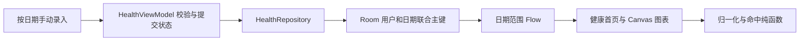
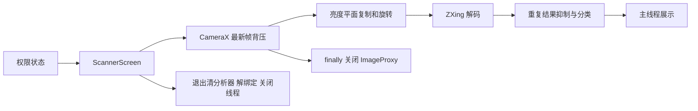

# 工程说明与简历表述

## 数据与图表

`feature/records` 负责数据边界和存储，`feature/chart` 负责图表几何与显示。保存动作捕获发起时的日期，避免异步提交写入后来选中的日期；忙碌期间合并重复提交。图表展示近七日数据，无记录日期补零。

## 相机所有权

扫码页创建单独分析线程并只解绑自身的 CameraX use cases。退出标记阻止延迟初始化/回调写入离开的页面；无相机权限时仍能操作健康记录。仅 http/https 且主机非空的结果展示打开链接按钮，不自动跳转。

## 简历可用表达

- 将健康图表归一化、弧角与柱形命中抽离为纯函数，实现自适应半圆环、柱状图和选中反馈；通过边界单测和不同宽度的 UI 回归验证空数据、负值、零目标及柱间空隙。
- 基于 CameraX 最新帧策略与 ZXing 构建二维码分析链路，处理亮度平面行步长、旋转、重复结果和文本/链接分类，统一关闭图像与页面分析资源，并验证真实二维码帧的解码和关闭行为。
- 使用 Room 联合主键定义用户/日期幂等更新，响应式驱动近七日图表；覆盖重复写入、用户隔离、逻辑删除、重新保存恢复和离线读取，并增加录入保存删除的 UI 回归。

根源码目录：`app/src/main/java/com/example/health/feature/`。业务数据仅为手动本地记录，不应在简历中扩写为自动采集、健康云平台或完整后端。

参考：[Compose Canvas](https://developer.android.com/develop/ui/compose/graphics/draw/overview)、[CameraX 图像分析](https://developer.android.com/media/camera/camerax/analyze)、[Room](https://developer.android.com/training/data-storage/room)、[Espresso Android 16 兼容修复](https://developer.android.com/jetpack/androidx/releases/test#espresso-3.7.0)。
